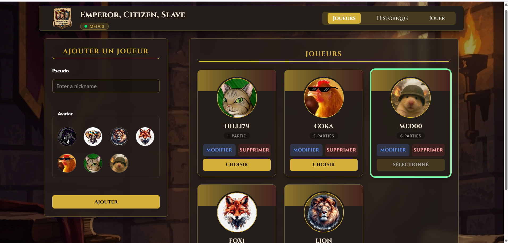
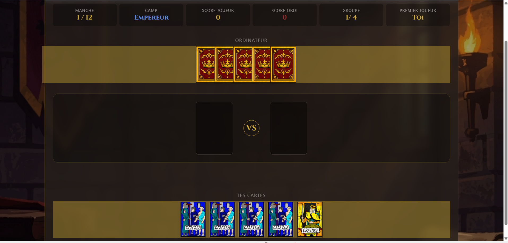
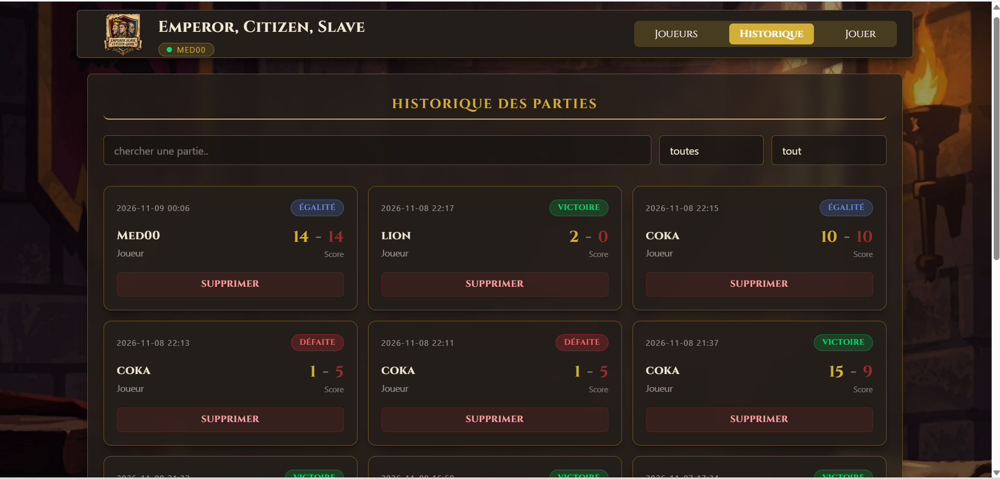

# Emperor, Citizen, Slave

Application web complète pour un club de jeu de cartes. Les membres créent leur profil, jouent des duels contre l'ordinateur (jeu « Empereur, Citoyen, Esclave ») et le club garde l'historique de toutes les parties.

## 🔗 Liens

- Site en ligne (GitHub Pages) : <lien>
- Tableau GitHub Projects : https://github.com/users/med00-co/projects/14


## 📸 Captures d'écran

### Profils des joueurs


### Partie en cours


### Historique des parties


## 🎮 Règles du jeu

- Le joueur affronte l'ordinateur en **12 manches**, réparties en **4 groupes de 3**.
- Empereur bat Citoyen, Citoyen bat Esclave, **Esclave bat Empereur**. Citoyen contre Citoyen : égalité.
- Chaque camp a 5 cartes : 4 Citoyens + 1 carte spéciale (Empereur ou Esclave).
- En cas d'égalité, les deux cartes sont retirées et le duel continue.
- La manche se termine dès qu'une carte gagne : **1 point** dans le camp de l'Empereur, **5 points** dans le camp de l'Esclave.
- Le joueur commence dans le camp de l'Empereur, et les camps changent après les manches 3, 6 et 9.
- À chaque duel, le premier à jouer alterne (Empereur, puis Esclave, etc.).

## ✅ Fonctionnalités

- [x] Profils : ajout avec validation du pseudo (3 à 15 caractères, lettres et chiffres, pseudo unique sans tenir compte de la casse), choix de l'avatar
- [x] Profils : affichage (avatar, pseudo, nombre de parties), modification, suppression avec confirmation
- [x] Choix du joueur actif (affiché dans l'en-tête)
- [x] Jeu : 12 manches, égalités, changement de camp, points de 1 ou 5, blocage des clics pendant le retournement des cartes, animation de retournement
- [x] Fin de partie : résultat et score, enregistrement dans l'historique, bouton « Rejouer »
- [x] Historique : liste de la plus récente à la plus ancienne, recherche par pseudo, filtres par résultat et par date (combinés), suppression avec confirmation
- [x] Les parties d'un joueur supprimé restent affichées avec le nom « Joueur supprimé »
- [x] Sauvegarde dans le LocalStorage : rien n'est perdu au rechargement de la page
- [x] Interface mobile-first avec Tailwind CSS (états survol, focus, erreur, bouton désactivé)

## 🛠️ Technologies

- HTML5
- Tailwind CSS v4 (CLI)
- JavaScript moderne (modules ES6+ : fonctions fléchées, déstructuration, spread, `map`, `filter`, `find`, `some`, `sort`)
- LocalStorage

## 📁 Rôle de chaque fichier

| Fichier | Rôle |
|---|---|
| `index.html` | Structure de la page (profils, jeu, historique) |
| `src/main.js` | Point de départ : écoute les clics et relie tous les fichiers |
| `src/game.js` | Règles du jeu uniquement (`duel()`, mains, manches, points, score). Il ne touche jamais à la page |
| `src/players.js` | Ajouter, modifier, supprimer les profils, valider le pseudo, choisir le joueur |
| `src/history.js` | Enregistrer les parties, chercher, filtrer, supprimer |
| `src/storage.js` | Lire et écrire dans le LocalStorage |
| `src/ui.js` | Tout ce qui s'affiche à l'écran |
| `styleCSS/input.css` | Couleurs, polices et animation personnalisées (Tailwind) |
| `styleCSS/output.css` | CSS généré par Tailwind (ne pas modifier) |

## 💾 Données sauvegardées (LocalStorage)

| Clé | Contenu |
|---|---|
| `ecd_joueurs` | Liste des profils (`id`, `nickname`, `avatar`, `createdAt`) |
| `ecd_joueur_choisi` | Identifiant du joueur actif |
| `ecd_parties` | Historique (`id`, `playerId`, `date`, `playerScore`, `computerScore`, `result`) |

## ▶️ Lancer le projet

1. Cloner le dépôt :
   ```bash
   git clone <lien du dépôt>
   cd <nom du dossier>
   ```
2. Installer les dépendances :
   ```bash
   npm install
   ```
3. Lancer la compilation de Tailwind (laisser le terminal ouvert) :
   ```bash
   npm run dev
   ```
4. Ouvrir `index.html` avec **Live Server**. Les modules JavaScript ne fonctionnent pas avec un double-clic sur le fichier.

## 🌿 Organisation Git

- `main` : version en ligne
- `develop` : version en cours
- Une branche par fonctionnalité (`feature/players-crud`, `feature/game-duel`, `feature/game-ui`, `feature/history-save`, `feature/history-filters`…)
- Chaque branche passe par une Pull Request relue par un camarade avant la fusion dans `develop`.
- Suivi de l'avancement avec GitHub Projects (une carte par fonctionnalité).

## ✨ Améliorations supplémentaires

- **Animation de retournement des cartes** : animation `flip` personnalisée avec Tailwind (`@keyframes` dans `input.css`), appliquée aux cartes jouées au centre de la table.
- **Tour de l'ordinateur en deux temps** : la carte du joueur apparaît d'abord, puis, après un court délai (`setTimeout`), celle de l'ordinateur et le résultat du duel.
- **Mains colorées selon le camp** (Empereur ou Esclave) et cartes de l'ordinateur superposées.
- **Formulaire de profil réutilisé** pour l'ajout et la modification, avec bouton « Annuler ».
- **Formulaire fixe sur ordinateur** (`sticky`) pendant le défilement de la liste des joueurs.

## ⭐ Bonus (liste du brief)

Aucun pour le moment.