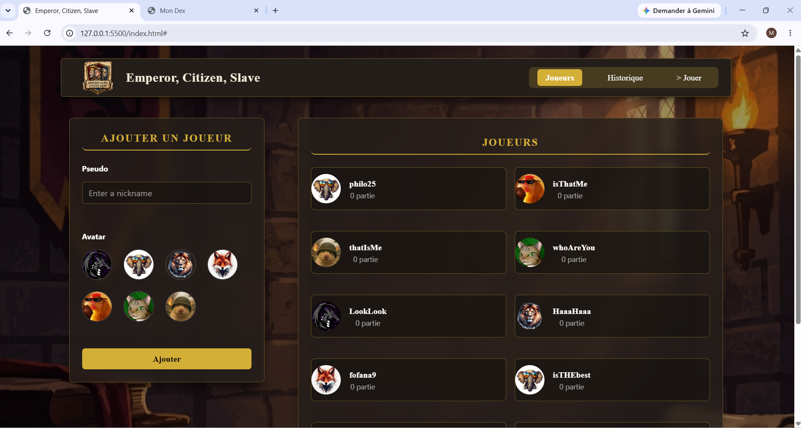

# Emperor, Citizen, Slave

Application web pour un club de jeu de cartes. Les membres créent leur profil, jouent des duels contre l'ordinateur (jeu « Empereur, Citoyen, Esclave ») et le club garde l'historique de toutes les parties pour organiser un classement.

## 🔗 Liens

- Site en ligne : <à ajouter pour le livrable 3>
- Tableau GitHub Projects : [<lien>](https://github.com/users/med00-co/projects/14)
- Pull Requests : [<lien PR 1>](https://github.com/med00-co/sp2-brief2-game_ECE/pull/13)

## 📸 Captures d'écran

### Liste des joueurs



## 🛠️ Technologies

- HTML5
- Tailwind CSS v4 (CLI)
- JavaScript moderne (modules ES6+)
- LocalStorage pour la sauvegarde des données

## 📁 Rôle de chaque fichier

| Fichier | Rôle |
|---|---|
| `index.html` | Structure de la page (profils, jeu, historique) |
| `src/main.js` | Point de départ : écoute les clics et relie les autres fichiers |
| `src/game.js` | Règles du jeu uniquement (mains, `duel()`, manches, score), sans toucher à la page |
| `src/players.js` | Ajouter, modifier, supprimer les profils et valider le pseudo |
| `src/history.js` | Enregistrer les parties, chercher et filtrer |
| `src/storage.js` | Lire et écrire dans le LocalStorage |
| `src/ui.js` | Tout ce qui s'affiche à l'écran |

## ▶️ Lancer le projet

1. Cloner le dépôt :
   ```bash
   git clone <lien du dépôt>
   cd <nom du dossier>
   ```
2. Installer Tailwind si nécessaire, puis lancer la compilation du CSS :
   ```bash
   npx @tailwindcss/cli -i ./styleCSS/input.css -o ./styleCSS/output.css --watch
   ```
3. Ouvrir `index.html` avec **Live Server** (les modules JavaScript ne fonctionnent pas avec un double-clic sur le fichier).

## ✅ Fonctionnalités

- [x] Profils : ajout avec validation du pseudo (format et doublons)
- [ ] Profils : modification, suppression, choix du joueur
- [ ] Jeu : 12 manches contre l'ordinateur
- [ ] Historique : affichage, recherche, filtres, suppression

## ⭐ Bonus réalisés

Aucun pour le moment.